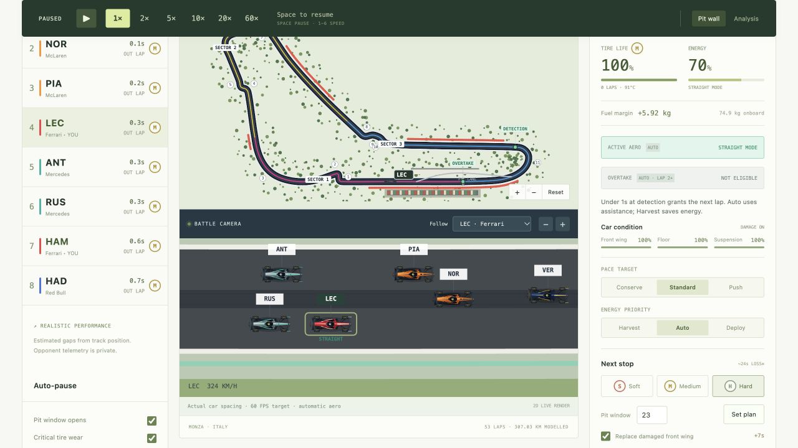
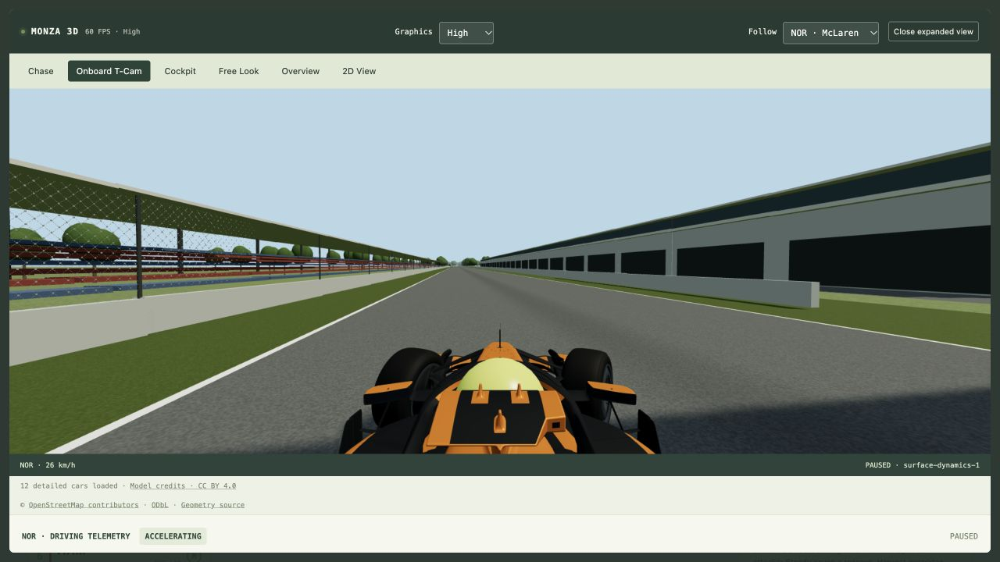

# Project Evidence

Ethan Marcin · AI 101 · Section 1

## Audience, purpose and two features

For Formula 1 fans and students learning race strategy: manage a team's pace/energy/pits, and follow twelve simulated drivers through 3D cameras with telemetry. See README.md for usage and limits.

## Meaningful revision: 2D strategy display → 3D race viewing

The initial prompt asked for a 2D strategist game with 3D as a later goal. The exact follow-up requested 3D Monza plus onboard/chase cameras; both prompts are preserved in AI_USE.md.

### Before — real earlier development screenshot

The earlier version showed the track as a map with a separate flat battle display. This image was captured during development; it is not a staged recreation of a failed test.

### After — real later development screenshot

The later version has a 3D road, detailed cars, selectable cameras and grounded wheels. It also shows corrected driver-right garages. These screenshots show different historical moments, not the same lap/seed comparison. Appearance alone does not validate physics. The later image was captured October 23, 2026 on the original host; neither image is GitHub Pages deployment proof.

## One problem solved: shaking front tires

The human reported excessive front-tire shaking. Visible steering followed rapid controller corrections directly, and backwards position corrections could re-seed wheel rotation. The assistant added a damped visual steering rack and continuous spin phases. Local regression tests checked countersteer, pause, frame subdivision and contact/pit transitions; all 111 tests passed. The exact bug prompt and verification limits are in AI_USE.md and TEST_LOG.md. Static screenshots cannot demonstrate wheel jitter; the attached report and test output provide the supporting evidence.

## Add after publication

GitHub Pages URL: https://ethanmarcin0.github.io/Formula-1-Stat-Game/
Repository URL: https://github.com/ethanmarcin0/Formula-1-Stat-Game
Live-site screenshot(s) and five actual test results: PENDING — add after you publish.
