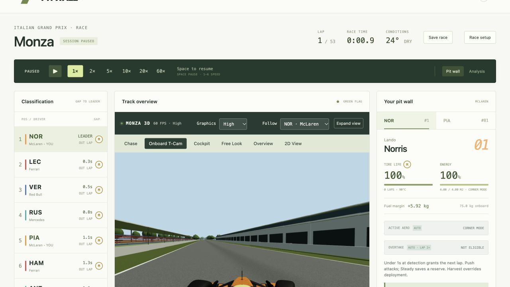

# Package checks — October 27, 2026

These are LOCAL package checks, not live GitHub Pages results.

- PASS: TypeScript `tsc --noEmit` in the editable portable source copy.
- PASS: Vite production build with `base: './'`; no external build service used.
- PASS: 21 local HTML links resolve within the package; root-absolute links are absent.
- PASS: runtime GLB, telemetry-reference and engineering-notes URLs are relative.
- PASS: local HTTP preview at `/ai101-midterm/` started a McLaren race, loaded all 12 detailed cars and rendered onboard with telemetry.
- PASS: pause stopped race time; Analysis loaded all six reference lap options from the nested path. No browser console errors were recorded during those checks.
- PASS: a final reload showed the corrected About → 3D notes URL under `/ai101-midterm/3d-research.html` after fixing an initially missed numeric-leading `/3d-...` path. The HTML link audit then passed again.
- PASS: static upload folder excludes node_modules, .git, .env, Sites hosting configuration/credentials, raw source Downloads models and the unverified Monza display mesh.
- Package size/file limits and archive integrity are recorded in the sibling package-manifest.json.

The full five-test assignment log remains PENDING on the real GitHub Pages host. These local checks preceded the Git upload. The game was subsequently committed and pushed to the repository linked in README.md; the original local checks are not being relabelled as GitHub Pages tests.
